<div align="center">

<picture>
  <source media="(prefers-color-scheme: dark)" srcset="media/pocket-dark.svg">
  
</picture>

**One shape on screen.** A notch hangs from the top edge and every panel on the
desktop unfolds out of it, like things out of a pocket. The colours are not in
the config — they come out of your wallpaper. And a team of pocket monsters
lives on your windows.

[](https://archlinux.org)
[](https://hypr.land)
[](https://quickshell.org)
[](LICENSE)

[The notch](#the-notch-is-the-interface) ·
[Colours](#change-the-wallpaper-change-everything) ·
[Panels](#everything-unfolds-out-of-it) ·
[The team](#a-team-of-six) ·
[Install](#install) ·
[Keys](#keys) ·
[The long version](#the-long-version)

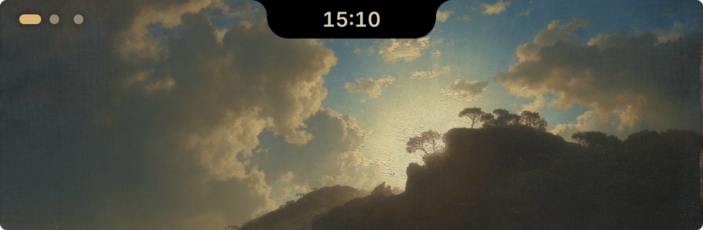

</div>

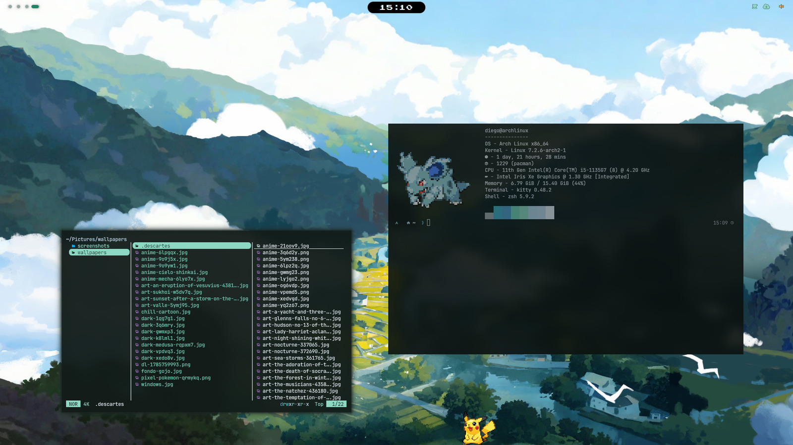

<div align="center">

**[Watch the tour on YouTube](https://www.youtube.com/watch?v=4Vdd0ckEusA)**

</div>

## The notch is the interface

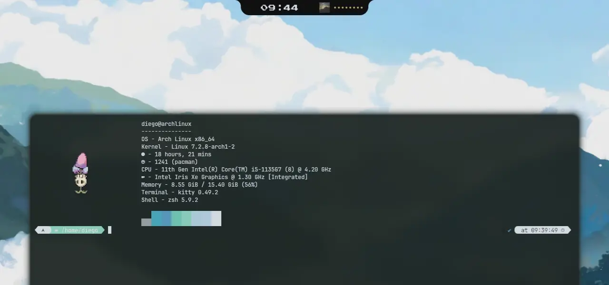

**It sits exactly as tall as the reserved band, so it can never cover a
window.** It grows only when you ask, and goes back. At rest it shows the time
and what is playing; everything else is a face it unfolds into, each the size of
what is in it.


<kbd>Super</kbd> <kbd>N</kbd> switches between the notch, flush with the edge,
and the island, a pill floating below it.

## Change the wallpaper, change everything

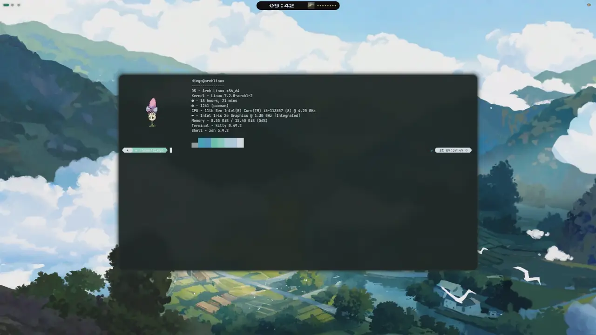

**The colours are not in the config.** pywal takes them from the wallpaper, and
GTK, Qt, the terminal, yazi, Spotify, the window borders, the lock screen and
the login greeter all follow — **without restarting a single program**.

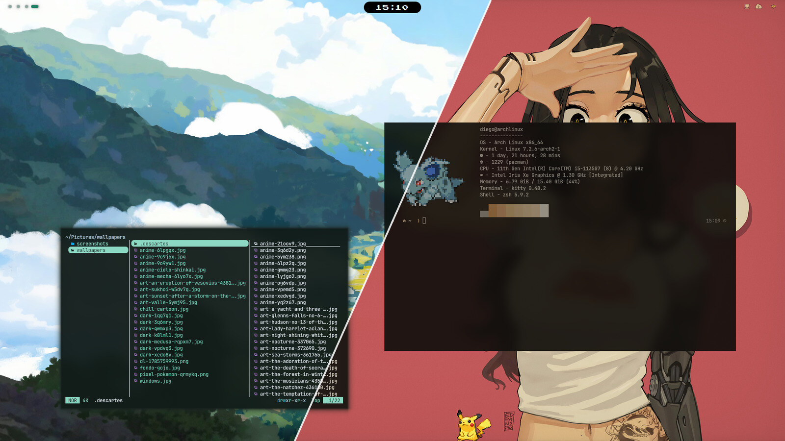

The picker unfolds from the notch with <kbd>Super</kbd> <kbd>Shift</kbd>
<kbd>W</kbd>, with the wallpapers in your folder or from the web.

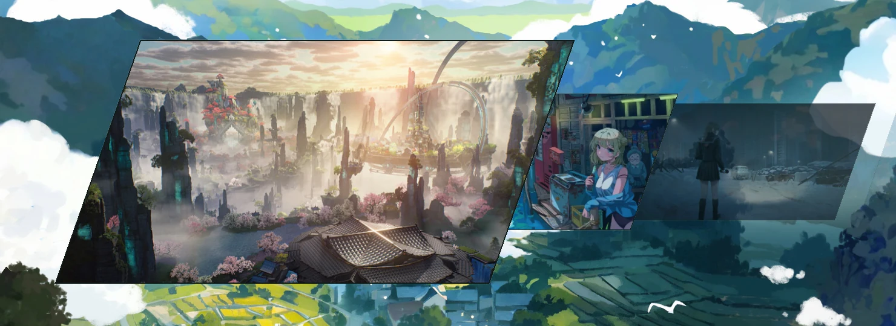

## Everything unfolds out of it

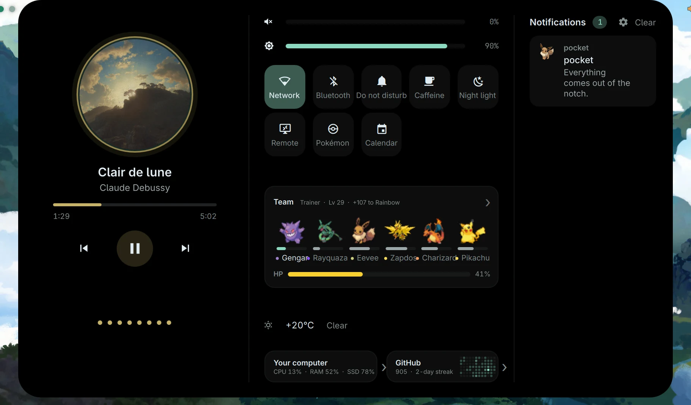

**Control Centre** — <kbd>Super</kbd> <kbd>D</kbd>. What is playing, the
sliders and toggles, the team, the weather, your computer, your GitHub streak
and every notification, in one face.

| | |
|:-:|:-:|
| 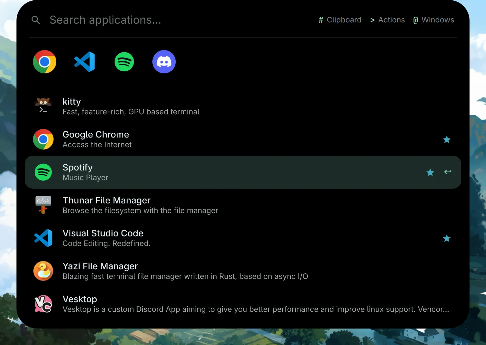 | 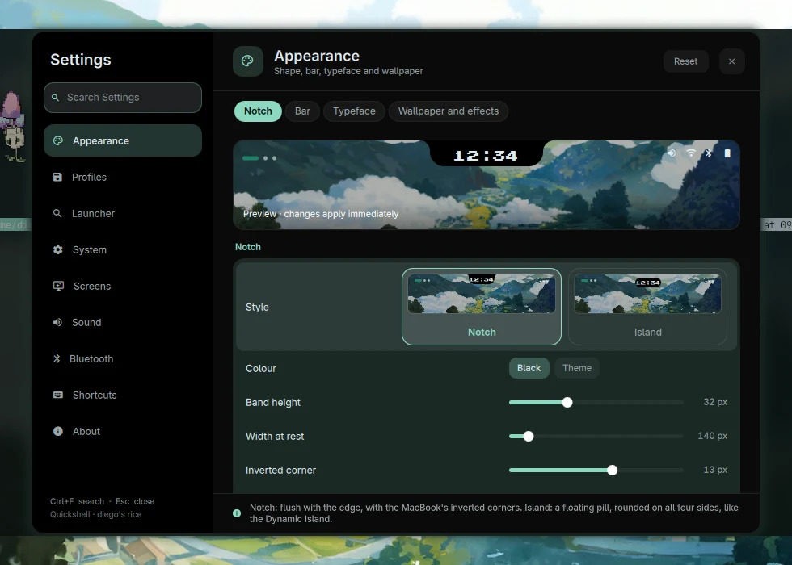 |
| **Launcher** — <kbd>Super</kbd> <kbd>R</kbd><br>ranked by what you open · `#` clipboard · `>` actions · `@` windows · sums · timers | **Settings** — <kbd>Super</kbd> <kbd>,</kbd><br>every change shows in the preview as you make it |
| 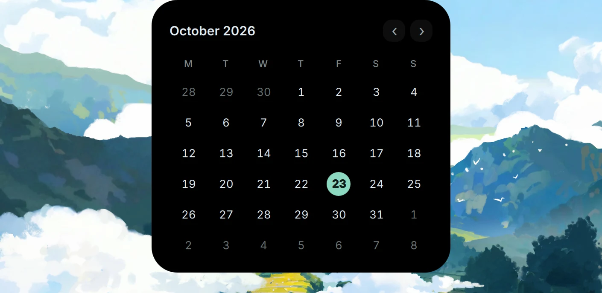 | 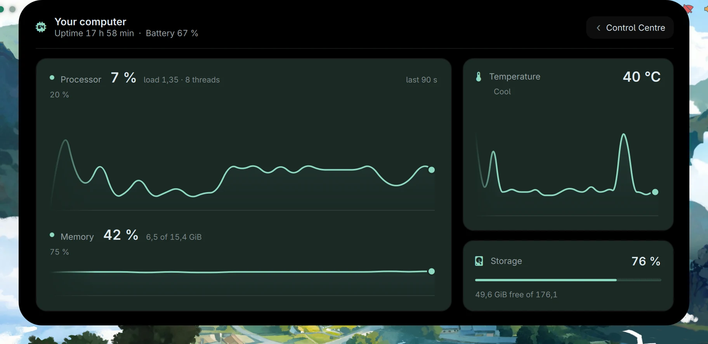 |
| **Calendar** — swipe down with three fingers | **Your computer** — <kbd>Super</kbd> <kbd>Shift</kbd> <kbd>D</kbd><br>processor, memory, temperature and storage |
| 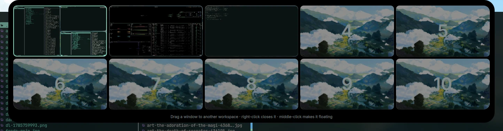 | 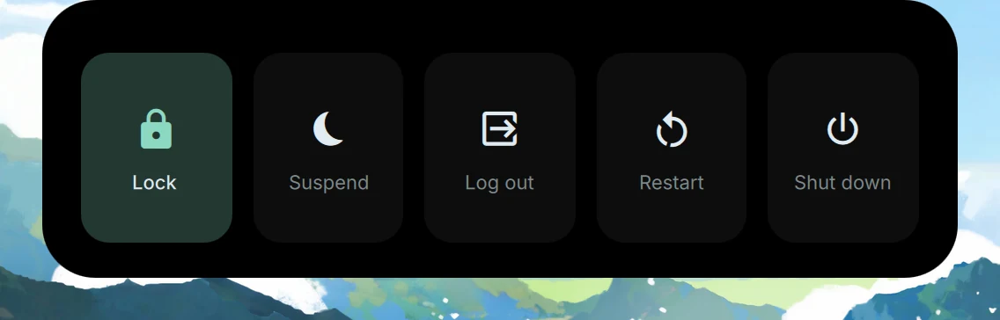 |
| **Workspace map** — <kbd>Super</kbd> <kbd>Tab</kbd><br>each cell is your screen to scale · drag a window to another one | **Power** — <kbd>Super</kbd> <kbd>Shift</kbd> <kbd>E</kbd> |

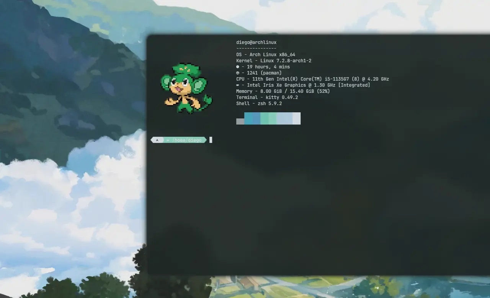

**Stage Manager** — push the pointer against the left edge. The other
workspaces slide in as stacks of their real windows, as on macOS; click one to
go there. <kbd>Super</kbd> <kbd>Shift</kbd> <kbd>Tab</kbd> or Settings turns it
on and off.

## A team of six

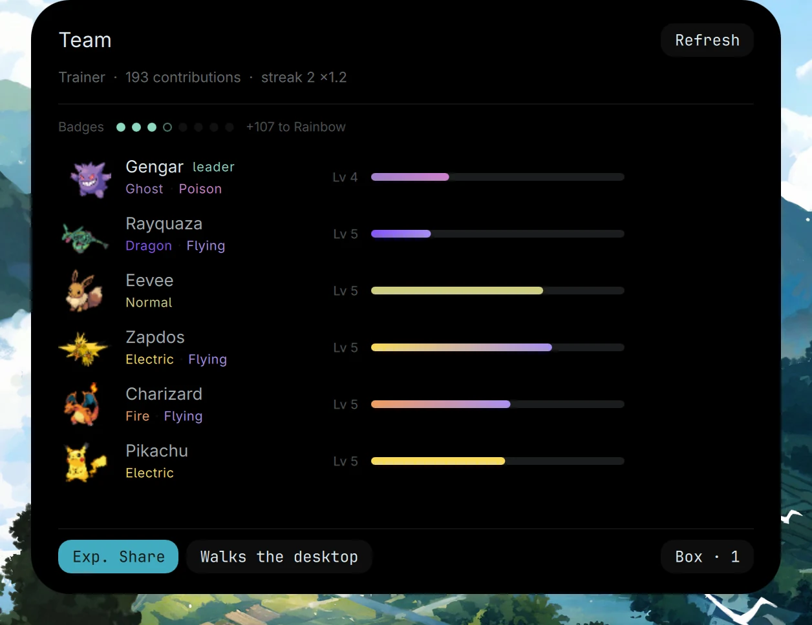

**It levels up from your GitHub commits.** `gh` counts your contributions, a
streak multiplies them, and the badges fill as you go. The leader walks on your
windows. <kbd>Super</kbd> <kbd>Shift</kbd> <kbd>O</kbd> opens the team.

## Install

```sh
git clone https://github.com/diegoMalagrida/dotfiles
cd dotfiles
./install.sh
```

Needs **Arch** and **Hyprland 0.56+** — the live config is `hyprland.lua`, not
`hyprland.conf`.

| | |
|---|---|
| `./install.sh -n` | print the whole plan, change nothing |
| `./install.sh --lang en` | pick the language; without it, it follows your locale (Spanish for `es_*`, English otherwise) |
| `./install.sh --copy` | copy the configs instead of symlinking them to the repo |
| `./install.sh restore` | undo it |
| `./diagnose` | what is missing or will not start |

**What it touches.** It installs the packages in `packages/`, building `yay`
first if it is missing, and lays `home/` into your `$HOME` as symlinks to the
repo; everything it replaces is saved to `~/.dotfiles-backup/` first. Three
steps write outside `$HOME`, and each asks for `sudo` first: `system` copies
`system/etc/` into `/etc`, `sddm` installs the login theme and `spicetify`
themes Spotify. It also detects your graphics card and installs its drivers,
enables the services in `packages/services.txt`, makes zsh your shell and
downloads the pokémon sprites, about 270 MB, which are not in git. It never
touches `/boot`, the bootloader or your partitions.

**First steps.** Run `gh auth login`, so the team can count your commits. Then
<kbd>Super</kbd> <kbd>Shift</kbd> <kbd>W</kbd> picks a wallpaper and
<kbd>Super</kbd> <kbd>K</kbd> shows every key.

It is made on a laptop with Intel graphics. [On a machine that is not this
laptop](home/.config/quickshell/README.en.md#on-a-machine-that-is-not-this-laptop)
says what changes.

## Keys

<kbd>Super</kbd> <kbd>K</kbd> shows all of them, live, on the Shortcuts page of
Settings. The ones to learn first:

| | |
|---|---|
| <kbd>Super</kbd> <kbd>Q</kbd> | terminal |
| <kbd>Super</kbd> <kbd>C</kbd> | close the window |
| <kbd>Super</kbd> <kbd>E</kbd> | files |
| <kbd>Super</kbd> <kbd>R</kbd> | launcher |
| <kbd>Super</kbd> <kbd>D</kbd> | Control Centre |
| <kbd>Super</kbd> <kbd>Shift</kbd> <kbd>W</kbd> | wallpaper picker |
| <kbd>Super</kbd> <kbd>Tab</kbd> | workspace map |
| <kbd>Super</kbd> <kbd>Shift</kbd> <kbd>O</kbd> | the team |
| <kbd>Super</kbd> <kbd>N</kbd> | notch or island |
| <kbd>Super</kbd> <kbd>1</kbd> … <kbd>0</kbd> | a workspace; with <kbd>Shift</kbd>, the window goes with you |
| <kbd>Super</kbd> <kbd>L</kbd> | lock |
| <kbd>Super</kbd> <kbd>,</kbd> | Settings |

<details>
<summary><b>What is inside</b></summary>

| Piece | Program | Where |
|---|---|---|
| Compositor | Hyprland, configured in Lua | `home/.config/hypr/hyprland.lua` |
| The notch, the panels, the launcher, Settings | Quickshell | `home/.config/quickshell` |
| Colours | pywal | `home/.config/hypr/set-wallpaper.sh`, `home/.config/wal` |
| Wallpaper | awww | `home/.config/hypr/awww-start.sh` |
| Lock screen | hyprlock | `home/.config/hypr/hyprlock.conf` |
| Login | SDDM, with the hyprisland theme | `home/.config/sddm-hyprisland` |
| Terminal | kitty, zsh with powerlevel10k | `home/.config/kitty`, `home/.config/zshrc.d` |
| Files | yazi, Thunar | `home/.config/yazi` |
| Music | Spotify with spicetify, cava | `home/.config/spicetify`, `home/.config/cava` |
| The leader on your windows | wl_shimeji | `home/.local/src/wl-shimeji-hyprland-cursor` |
| Boot splash | Plymouth | `home/.local/bin/poke-plymouth` |
| Cursor | Bibata, hypr-dynamic-cursors | `packages/aur.txt` |

</details>

## The long version

The shell documents itself in about 1 400 lines — every decision, every
measurement, every trap that cost an evening:
**[English](home/.config/quickshell/README.en.md)** ·
**[Castellano](home/.config/quickshell/README.md)**

## Licence

**GPL-3.0 for the code and configuration here** — see [LICENSE](LICENSE). Third
party material keeps its own licence and is not relicensed by that line: the
Google Sans Flex package is OFL-1.1, the yazi flavour is MIT, and the
[wallpapers are not mine](home/Pictures/wallpapers/SOURCES.md).

## Credits

- [Impasto](https://github.com/andreumassanet/impasto) — GPL-3.0
- caelestia · end-4 / illogical-impulse
- [surface-dots](https://github.com/snes19xx/surface-dots) · Tide-island
- [wl_shimeji](https://github.com/CluelessCatBurger/wl_shimeji) · [Eevee by cachomon](https://sprites.shimejis.xyz/directory/pokemon-eevee-by-cachomon)
- [PokeAPI](https://pokeapi.co) · [plymouth-pokemon](https://github.com/realChesta/plymouth-pokemon)
- [hypr-dynamic-cursors](https://github.com/VirtCode/hypr-dynamic-cursors) · [termspot](https://github.com/fdeox/termspot) · [Bibata](https://github.com/rtgiskard/bibata_cursor)

Standing on [Hyprland](https://hypr.land), [Quickshell](https://quickshell.org),
pywal, awww, cava, kitty, yazi and spicetify.

The two paintings that come back throughout, in the banner, on the cartridge's
label, on the player's cover and in the repaint loop, are Andreas Achenbach's
[*Sunset after a Storm on the Coast of
Sicily*](https://www.metmuseum.org/art/collection/search/437975) (1853) and
Johan Christian Dahl's [*An Eruption of
Vesuvius*](https://www.metmuseum.org/art/collection/search/438159) (1824), both
public domain at The Met.

Pokemon is a trademark of Nintendo, Creatures Inc. and GAME FREAK inc. This is a
personal desktop configuration and is not affiliated with them.
